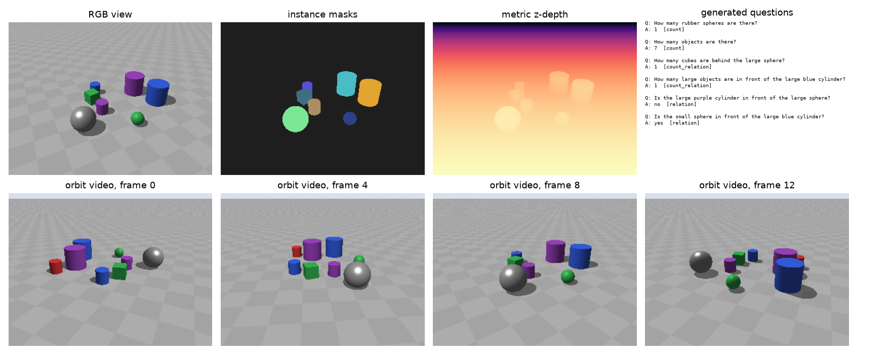

# Spatial Scene Bench

[](https://github.com/selfishout/spatial-scene-bench/actions/workflows/tests.yml)


**Procedural 3D scenes with exact ground truth for probing counting and relational reasoning in vision-language
models, from single images to multi-view video.**



Recent benchmarks such as VSI-Bench, CV-Bench, SpatialScore and MindCube show that VLMs still struggle with 3D
spatial reasoning: counting under occlusion, metric distance, and perspective-taking. Real-world benchmarks are
expensive to extend and their labels are noisy. This repository generates unlimited, fully controllable scenes
where **every answer is computed from the 3D scene itself**, so it can serve as:

- a diagnostic benchmark with per-skill breakdowns,
- a source of verifiable training data for RL / GRPO (see [spatial-r1-vlm](https://github.com/selfishout/spatial-r1-vlm)),
- a testbed for 3D perception pipelines, since depth maps, instance masks and camera poses are exported for every frame
  (see [scene-graph-spatial-reasoner](https://github.com/selfishout/scene-graph-spatial-reasoner)).

## Features

- **Pure NumPy ray tracer**: spheres, rotated cubes and capped cylinders with shadows and specular "metal"
  materials; renders RGB, metric z-depth and instance ids. No Blender, no GPU, deterministic, a fraction of a second per 320×240 frame on a laptop CPU.
- **OpenCV-convention cameras** with exported intrinsics `K` and `cam_to_world` for every view and video frame.
- **11 question types**, all with **ambiguity filtering**: objects with only a few visible pixels, relations within
  a pixel or depth margin, and near-ties in distance are rejected instead of producing noisy labels.
- **Occlusion-aware counting**: counts refer to what is actually visible in the image, or across the video.
- **Video questions on orbit trajectories**: count each physical object once across frames, metric distance, and
  allocentric-to-egocentric direction.
- **Evaluation harness** for any Hugging Face VLM (`hf:<model-id>`), any OpenAI-compatible endpoint including vLLM
  and SGLang (`openai:<model>`), and a chance baseline, with VSI-Bench-style **Mean Relative Accuracy** for numeric
  answers.

| Type | Example | Answer |
| --- | --- | --- |
| `count` | How many large metal objects are there? | integer |
| `count_relation` | How many cubes are to the left of the red sphere? | integer |
| `relation` | Is the small cylinder behind the blue cube? | yes / no |
| `compare_count` | Are there more spheres than cylinders? | yes / no |
| `closest` | Which object is closest to the gray cube in 3D space? (A)…(D) | choice |
| `distance` | What is the distance between the center of A and the center of B, in meters? | number (MRA) |
| `ego_direction` | Imagine you are standing at A and facing B. Where is C relative to you? | front/back × left/right |
| `video_count` | How many red objects are in this room? Count each physical object only once. | integer |
| `video_distance`, `video_closest`, `video_ego_direction` | same as above, from orbit frames | |

## Quick start

```bash
pip install -e .            # numpy + pillow only
ssb-generate --out data/ssb --num-scenes 200 --video-frames 16 --seed 2025

ssb-eval --data data/ssb --model random
pip install -e ".[hf]"
ssb-eval --data data/ssb --model hf:Qwen/Qwen2.5-VL-3B-Instruct --per-type 25 --out results/qwen.jsonl
ssb-eval --data data/ssb --model openai:gpt-4o-mini     # or any vLLM server via OPENAI_BASE_URL
```

```python
import numpy as np
from spatial_scene_bench import sample_scene, render, generate_questions
from spatial_scene_bench.camera import default_camera

scene = sample_scene(np.random.default_rng(0), "demo", num_objects=10)
cam = default_camera()
out = render(scene, cam)                       # out.rgb, out.depth, out.instance
qs = generate_questions(scene, [(cam, out.visible_pixels())], None, np.random.default_rng(0))
```

### Hugging Face dataset and lmms-eval

The 200-scene test set is on the Hub as [alithema/spatial-scene-bench](https://huggingface.co/datasets/alithema/spatial-scene-bench)
(`full`: 4,387 questions, `mini`: 25 per type), with all images embedded:

```python
from datasets import load_dataset
ds = load_dataset("alithema/spatial-scene-bench", "mini", split="test")
```

A task for [lmms-eval](https://github.com/EvolvingLMMs-Lab/lmms-eval) with the same scoring is proposed in
[lmms-eval#1574](https://github.com/EvolvingLMMs-Lab/lmms-eval/pull/1574):

```bash
python -m lmms_eval --model qwen2_5_vl --model_args pretrained=Qwen/Qwen2.5-VL-3B-Instruct \
    --tasks spatial_scene_bench_mini --batch_size 1
```

`scripts/export_hf.py` rebuilds the Hub dataset from any generated split.

## First results

The dataset has 200 scenes, 6–12 objects each, 320×240 resolution, one random view plus a 16-frame orbit per
scene (`--seed 2025`, 4,387 questions). Qwen2.5-VL-3B-Instruct was run zero-shot with greedy decoding on the first
25 questions of each type, with 8 uniformly sampled frames for video questions. Chance is the random baseline on
all 4,387 questions.


| Question type | Chance | Qwen2.5-VL-3B |
| --- | ---: | ---: |
| count (acc / MRA) | 12.2 / 19.3 | **72.0 / 83.6** |
| count_relation | 10.8 / 15.2 | **76.0 / 79.2** |
| relation | 53.8 | **92.0** |
| compare_count | 48.4 | **92.0** |
| closest | 24.4 | **64.0** |
| ego_direction | 24.0 | 40.0 |
| distance (MRA) | 27.4 | 1.6 |
| video_count (acc / MRA) | 7.2 / 16.5 | 24.0 / 44.4 |
| video_closest | 24.1 | 52.0 |
| video_ego_direction | 23.0 | 40.0 |
| video_distance (MRA) | 28.7 | 0.0 |

These are small-sample numbers (n = 25 per type), so treat them as indicative. The pattern matches what VSI-Bench
reports on real videos. Single-view counting and viewer-centric relations are largely solved. Performance drops
sharply when the model must **integrate across frames** (video counting), **take another viewpoint** (egocentric
direction), or **reason metrically**: absolute distances are underestimated by an order of magnitude. Per-type
summaries are in [`results/`](results).

## Roadmap

- [ ] Larger model sweep (Qwen2.5/3-VL 7B, InternVL3, LLaVA-OneVision, GPT-4o) on the full set
- [ ] Room-scale mode with narrow field of view, so that no single frame shows every object and video counting
      requires real cross-frame integration (with the current orbits, the best single frame usually sees everything)
- [ ] Harder relational templates: multi-hop ("the object left of the cube that is behind…") and between-ness
- [ ] Textured backgrounds and distractors to close the sim-to-real gap; export in lmms-eval / VLMEvalKit formats

## Related work

[CLEVR](https://github.com/facebookresearch/clevr-dataset-gen) ·
[Super-CLEVR](https://github.com/Lizw14/Super-CLEVR) ·
[CLEVRER](https://github.com/chuangg/CLEVRER) ·
[VSI-Bench](https://github.com/vision-x-nyu/thinking-in-space) ·
[SpatialScore](https://github.com/haoningwu3639/SpatialScore) ·
[MindCube](https://github.com/mll-lab-nu/MindCube) ·
[Cambrian-1 / CV-Bench](https://github.com/cambrian-mllm/cambrian) ·
[SpatialRGPT](https://github.com/AnjieCheng/SpatialRGPT) ·
[VQASynth](https://github.com/remyxai/VQASynth)

## License

MIT
